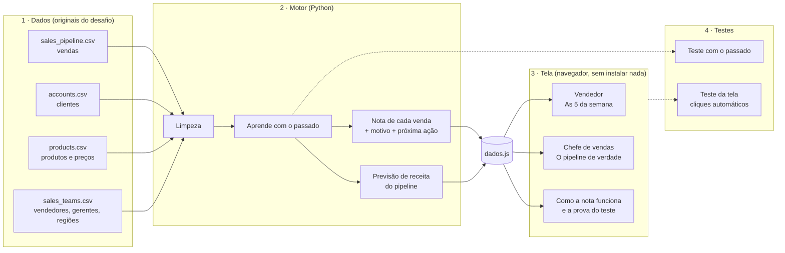

# Arquitetura — Lead Scorer "Segunda-feira"

## O problema em uma frase

Os vendedores escolhem "no feeling" onde gastar o tempo: perdem tempo com vendas que não vão fechar e deixam esfriar as boas. A ferramenta diz ao vendedor **as 5 vendas da semana**, com o motivo e a próxima ação, e mostra à chefe de vendas **quanto do pipeline é real**.

## Visão geral



## As partes

| Parte | O que faz | Tecnologia |
|---|---|---|
| **1. Dados** | As 4 tabelas originais do desafio, sem alteração | CSV |
| **2. Motor** | Lê e limpa os dados, aprende com o passado, dá a nota de cada venda, escreve o motivo e a próxima ação, calcula a previsão de receita e grava tudo em `dados.js` | Python + pandas |
| **3. Tela** | Página estática que só lê `dados.js`. Abre com dois cliques ou por link | HTML + CSS + JavaScript |
| **4. Testes** | Conferem a nota contra o que aconteceu no passado e clicam em todos os botões da tela | Python e navegador automático |

## Decisões

- **O motor roda uma vez e grava um arquivo; a tela só lê.** Assim a página abre sem servidor e sem instalação, que é o que a chefe de vendas pediu: simples, mas funcionando.
- **Separar motor e tela.** No futuro, o motor pode ler direto do CRM em vez dos CSVs, sem mexer na tela. A tela também pode virar e-mail ou mensagem sem mexer no motor.
- **Testar sem olhar o futuro.** Para saber se a nota funciona, o motor volta a datas do passado, só enxerga o que se sabia naquele dia e depois conferimos o que aconteceu.

## Como a nota é calculada

1. **Chance pelo tempo aberta**, medida em 12 fotos do passado (só vendas com cliente).
2. **Ajuste pela relação vendedor-cliente:** 57% quando o vendedor já ganhou com o cliente, 48% sem histórico.
3. **Valor esperado = chance × preço do produto.**
4. **Nota de 0 a 100** = posição do valor esperado entre as vendas abertas.
5. **As 5 da semana** = as 5 vendas de maior valor esperado de cada vendedor, fora as paradas (mais de 138 dias) e as sem cliente, que vão para as listas de limpeza.
6. **Previsão da chefe** = soma dos valores esperados das vendas vivas e com cliente.

## Prova de que funciona

`solution/testes/teste_passado.py`, 4 datas de 2017, o motor só enxerga o que se sabia em cada dia. Focando nos 20% do topo:

| Jeito de escolher | Receita dos 90 dias seguintes capturada |
|---|---|
| **Nota do Lead Scorer** | **59,2%** |
| Nota só pelo tempo aberta | 56,4% |
| Só o maior preço | 48,4% |
| Nota "óbvia" (taxa do vendedor no produto × preço) | 45,3% |
| Ao acaso | 20,0% |

O mesmo teste confere a previsão (o CRM mostrou 3 a 5 vezes o que entrou; a previsão errou de 12% a 35% para cima) e que o motor não espia o futuro. `solution/testes/teste_tela.mjs` clica em tudo na tela (32 conferências).

## Estrutura da pasta

```
├── README.md            entrega no formato do G4
├── solution/
│   ├── data/            os 4 CSVs originais
│   ├── analise/         scripts que olham os dados e reproduzem cada número
│   ├── motor/           o motor de nota (Python)
│   ├── app/             a tela (HTML, CSS, JS e dados.js)
│   └── testes/          teste com o passado e teste da tela
├── docs/                esta arquitetura e o resultado dos testes
└── process-log/         o registro de cada etapa
```

_Os números deste documento saem dos scripts de `solution/analise/` e `solution/testes/`._
